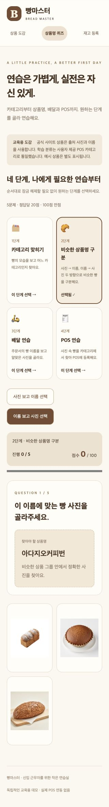

# 빵마스터 · Bread Master

베이커리 신입 근무자가 상품의 모습·이름·POS 위치를 익히고 계산 및 재고 입력을 연습하는 반응형 웹 앱입니다.

실제 근무 중 겪은 상품명 혼동과 POS 카테고리 탐색의 어려움에서 출발한 개인 프로젝트입니다. 현재는 **개발용 데모**이며 실제 POS·결제·재고 시스템과 연결하지 않습니다.

## 현재 구현

| 메뉴 | 가능한 작업 |
| --- | --- |
| 상품 도감 | POS와 같은 카테고리·5×5 배치, 상품 검색·상세, POS 미배치 상품 조회 |
| 카테고리 퀴즈 | 상품 사진을 보고 실제 POS 분류 선택 |
| 유사 상품명 퀴즈 | 같은 그룹 안에서 사진→이름 또는 이름→사진 선택 |
| 배달 기본 | 상품명만 보고 4개 사진 중 정답 선택 |
| 배달 심화 | 주문서 확인, 사진을 반복해서 눌러 수량만큼 포장, 장바구니 수정·제출 |
| POS 연습 | 여러 빵 사진·수량 확인, 상품 반복 등록, 행 삭제, 결제로 전체 주문 채점 |
| 재고 등록 | 총수량 수정·등록·카테고리 저장, 저장 전 카테고리 이동 제한 |

일반 퀴즈는 5문제, 정답당 20점, 100점 만점입니다. POS는 5주문을 채점하고, 배달 심화는 주문당 20점의 자유 연습입니다. 재고 등록에는 출제나 채점이 없습니다.

서버가 답안을 검증하고 최초 제출 결과를 저장해 반복 제출로 점수가 바뀌지 않도록 합니다. 화면의 라운드 점수는 모드 변경·새로고침 시 초기화됩니다. 개인 계정별 학습 기록은 아직 구현하지 않았습니다.

## 화면 예시

아래는 유사 상품명 그룹을 적용한 뒤 실제 앱에서 저장한 모바일 화면입니다. 이번 README 정리에서 새로 촬영한 이미지는 아닙니다.

<details>
<summary>이름을 보고 사진 선택하기 화면 펼치기</summary>



</details>

## 데이터 기준

- **학습 분류:** 휴면반죽단과자 / 휴면반죽기타 / 휴면반죽식빵 / 페스츄리 / 파이류 / 바게트 / 도우넛.
- **POS 설정:** 사용자 제공 자료로 구성한 7개 분류·78개 메뉴의 이름·가격·칸 위치를 [pos-layout.json](backend/data/pos-layout.json)에 저장합니다. 상단의 다른 POS 카테고리 버튼은 유지하지만 미등록 메뉴는 채우지 않습니다.
- **공식 상품 원본:** 공식 브레드 목록에서 수집한 176개 상품의 이름·사진 URL·출처는 [paris-bread.json](backend/data/paris-bread.json)에 보관합니다.
- 공식 사이트의 간식빵·건강빵 같은 분류는 학습에 사용하지 않습니다. 미확인 상품은 POS 미분류로 표시하고 퀴즈에서 제외합니다.
- POS에 등록한 상품 가격은 사용자 제공 값입니다. 미배치 원본 상품에는 가격이 없을 수 있습니다. 사이트 원본과 POS 별칭·가격을 별도로 관리합니다.
- 사진을 확인하지 못했거나 같은 공식 상품명이 여러 페이지에 존재하면 임의로 연결하지 않고 **사진 확인 필요**로 표시합니다.
- 사진은 공식 사이트 URL을 참조하는 참고 이미지입니다. 묶음·반쪽 상품의 실제 구성과 다를 수 있고, 원본 변경·삭제 시 표시되지 않을 수 있습니다. 상품 이미지의 권리는 원 출처에 있습니다.

### 유사 이름 그룹

| 그룹 | POS 상품 |
| --- | --- |
| 롤치즈 | 기타 8입)롤치즈빵 / 식빵 1/2뜯어먹는롤치즈브레드 |
| 커피·모카 | 기타 아다지오커피번 / 식빵 카페모카빵 / 식빵 모카크림샌드빵 |

기타·식빵은 각각 휴면반죽기타·휴면반죽식빵을 뜻합니다. 확정한 5개 상품으로 중복 없는 5문제를 구성하고, 같은 그룹의 2~3개 상품만 보기에 사용합니다. 그룹은 POS 설정의 name_group에 저장합니다.

모카크림빵과 치즈케이크 그룹은 정확한 상품명·POS 분류 확인 전까지 보류합니다.

### 연습별 동작

- 배달 심화: 주문당 2~4종, 수량은 1개 80% / 2개 16% / 3개 3% / 4개 1%. 후보 사진은 최대 15개이며 사용 가능한 상품 수에 따라 줄어듭니다.
- POS: 주문당 1~3종의 사진과 수량을 제시합니다. 사진 속 주문과 등록한 전체 상품·수량이 일치해야 정답입니다. 상품을 누르면 수량이 1개씩 늘어나고 ×는 해당 상품 행 전체를 삭제합니다.
- 빵류: 이름을 유지한 채 직접 단가를 입력·수정하는 특수 메뉴입니다. 현재 결제 연습 채점 기준은 상품·수량 일치이며 실제 결제는 하지 않습니다.
- 재고: 초기 연습 재고는 상품당 3개입니다. 새 빵 4개가 추가되면 총수량을 7로 수정합니다. 0~9999 사이 정수만 저장합니다. 직접 단가 메뉴인 빵류는 제외합니다.
- 재고 저장 결과는 같은 브라우저 탭에서 새로고침해도 복원됩니다. 등록만 하고 저장하지 않은 변경은 복원하지 않습니다. 기존 세션은 생성 당시 배치를 유지하므로 새 배치는 '새 재고 연습'으로 시작합니다.

## 기술과 구조

| 영역 | 기술·역할 |
| --- | --- |
| 프론트엔드 | React · TypeScript · Vite · Tailwind CSS, 화면·입력·라운드 상태 |
| 백엔드 | Python · FastAPI, 문제 출제·검증·채점·연습 저장 |
| 데이터베이스 | SQLite, 상품 원본·문제·답안·배달 주문·재고 연습 |
| 검증 | pytest, TypeScript 빌드, oxlint, GitHub Actions |

주요 모듈:
- frontend/src/features/catalog: 도감
- frontend/src/features/learning: 단계 선택·일반 퀴즈·점수
- frontend/src/features/delivery: 배달 심화
- frontend/src/features/pos: 공통 POS 화면·결제 연습
- frontend/src/features/inventory: 재고 연습
- backend/app/learning.py: 출제·채점
- backend/app/pos.py: 공식 상품과 사용자 POS 설정 연결
- backend/app/delivery.py: 배달·POS 주문 검증
- backend/app/inventory.py: 재고 연습 저장
- backend/app/db.py: SQLite 초기화·예시 데이터

## 공개 데모 배포 준비

Render 무료 Docker 웹 서비스용 설정을 추가했습니다. 배포 계정 연결 및 실제 공개 URL 확인은 아직 필요합니다. [가입·배포 안내](docs/deployment.md)를 참고하세요. 성공한 공개 URL은 실제 배포 확인 후 반영합니다.

## 로컬 실행

GitHub Actions는 Node.js 24와 Python 3.12에서 검사합니다. 로컬 Python 3.9에서도 기존 테스트를 실행했습니다.

### 1. 백엔드

프로젝트 루트에서:

```sh
cd backend
python3 -m venv .venv
./.venv/bin/python -m pip install -r requirements.txt
./.venv/bin/python -m uvicorn app.main:app --reload --host 127.0.0.1 --port 8000
```

### 2. 프론트엔드

새 터미널에서 프로젝트 루트로 이동한 후:

```sh
cd frontend
npm ci
npm run dev
```

웹: http://127.0.0.1:5173/ · API 문서: http://127.0.0.1:8000/docs

Vite가 /api 요청을 백엔드에 전달합니다. SQLite 파일 backend/bread.db는 자동 생성되며 Git에는 포함하지 않습니다.

### 3. 공식 상품 데이터 등록

처음 복제한 저장소에는 로컬 DB가 없으므로 예시 상품으로 시작합니다. 저장소에 보관된 공식 상품 목록을 적용하려면 프로젝트 루트에서 다음을 실행합니다.

```sh
backend/.venv/bin/python backend/scripts/import_paris.py
```

등록 스크립트는 기존 DB를 백업하고 출처 URL을 기준으로 중복을 방지합니다. 공식 상품이 있으면 사용자 POS 설정과 연결해 학습합니다. 이 단계는 보관된 목록을 등록하며 상품 사진 파일은 다운로드하지 않습니다.

공식 목록을 새로 수집하려면 collect_paris.py를 실행합니다. 외부 사이트 접근이 필요하며, 사이트 변경 시 수집 결과를 검수해야 합니다. POS 이름·가격·분류 설정을 원본 사이트 분류로 덮어쓰지 않습니다.

### VS Code와 Figma

bread-master.code-workspace를 열고 추천 확장을 설치합니다. '터미널 → 작업 실행'에서 Bread Master: API와 Bread Master: Web을 실행할 수 있습니다.

[초기 도감·POS Figma 초안](https://www.figma.com/design/HYUdIHeWPNGj0WaK8CMZr0)은 현재 구현과 차이가 있습니다. 최신 동작은 코드와 앱을 기준으로 확인합니다. VS Code의 Figma MCP 연결은 별도 인증이 필요합니다.

## 검증과 GitHub 관리

프론트엔드:

```sh
cd frontend
npm run build
npm run lint
```

백엔드:

```sh
cd backend
./.venv/bin/python -m pytest -q
```

현재 백엔드 테스트는 38개이며 그룹 내 보기·중복 없는 출제·서버 채점·반복 제출·재고 저장·입력 검증 등을 확인합니다. PR과 develop/main 푸시에는 CI가 빌드·린트·테스트를 실행합니다.

이슈 → 작업 브랜치 → 검증 → develop 대상 PR → CI 통과 및 변경 검토 → squash 병합으로 관리합니다. main은 첫 발표·배포 요청 시 생성합니다. 화면 변경은 스크린샷을, 데이터·백엔드·문서 변경은 관련 검증 자료 또는 스크린샷 미첨부 이유를 PR에 남깁니다.

[GitHub 개발 관리](docs/github-workflow.md) · [작업 기준](AGENTS.md)

## 미구현 및 다음 단계

- 회원가입·로그인·근무 지점 설정
- 개인별 오답 노트·학습 통계·경험치·레벨
- 관리자 상품 관리·이미지 업로드
- 보류 상품의 이름·사진·POS 분류 검수
- 신입 근무자 대상 탐색 시간·주문 오류 측정
- 배포·백업 정책 확정

현재 답안과 연습 결과는 계정별로 분리되지 않습니다. 학습 효과에 대한 사용자 실험 결과나 실제 급여·보상 연동 기능은 아직 없습니다.
