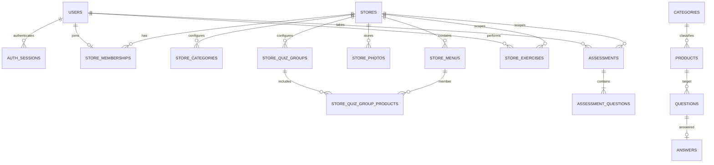

# 빵마스터 ERD

SQLite의 계정·매장·연습·평가 관계를 기록합니다.

## 현재 SQLite 구조

### 현재 주요 테이블

| 테이블 | 역할 | 주요 관계/메모 |
| --- | --- | --- |
| `users` | 계정과 비밀번호 해시 | `auth_sessions`, `store_memberships`, `store_exercises` |
| `auth_sessions` | 만료가 있는 로그인 세션 | 사용자별 여러 세션 가능 |
| `stores` | 매장과 초대 코드 | memberships와 메뉴/그룹의 데이터 범위 |
| `store_memberships` | 매장 소속·역할·승인 상태 | 현재 사용자당 하나의 소속 레코드, 역할 admin/worker |
| `store_categories`, `store_menus` | 매장 POS 분류·메뉴 | 상품 ID, POS 카테고리·칸·이름·가격·사진 참조 |
| `store_photos` | 매장 범위 상품 사진 데이터 | 메뉴의 `illustration`에서 참조 |
| `store_quiz_groups`, `_products`, `_settings` | 승인형 유사 상품 그룹과 N:M 상품 관계 | 추천 상태·출제 활성화·생성 상태 관리 |
| `store_exercises` | 매장 회원의 연습 기록 | 퀴즈 문항·주문·재고 세션마다 한 행. 사용자·매장·모드·스냅샷·정오·완료 시각 |
| `assessments` | 10문항 평가 응시 | 사용자·매장·정책 버전·시작/제출 시각·확정 결과. 사용자와 매장 조합당 진행 중 응시 1개 |
| `assessment_questions` | 평가 문항 | 응시 ID·문항 순서·보기 스냅샷·서버 정답 키·선택 답안 |
| `categories`, `products` | 공개/개발 상품 카탈로그 | 계정 매장 메뉴와 별도 모델 |
| `questions`, `answers` | 공개 체험 문항과 첫 제출 답안 | `answers`는 사용자 ID를 갖지 않아 개인 학습 이력으로 쓸 수 없음 |
| `delivery_orders`, `inventory_practices` | 배달·POS 주문과 재고 연습 상태 | 매장 계정으로 시작한 경우 같은 ID의 `store_exercises`에서 소유자를 확인 |

## 기록 저장과 조회

- 퀴즈 채점은 당시 상품과 결과를 `store_exercises.snapshot`에 저장합니다. 새 문제는 표시한 보기까지 저장해 복습을 지원합니다. 기존 기록은 기존 스냅샷을 그대로 조회합니다.
- 주문 차이는 `delivery_orders.result`를 사용합니다. 채점하지 않는 재고 연습은 풀이 통계와 오답 노트에서 제외합니다.
- 평가 테이블은 기존 DB 초기화 시 추가됩니다. 별도 응시 문항을 사용하므로 연습 채점 API로 평가 정답을 조회할 수 없습니다.
- 제출은 답안 존재를 확인하고 결과와 시각을 한 트랜잭션에 저장합니다. 반복 제출은 최초 확정 결과를 반환합니다. 관리자 조회는 확정 결과 요약만 반환합니다.
