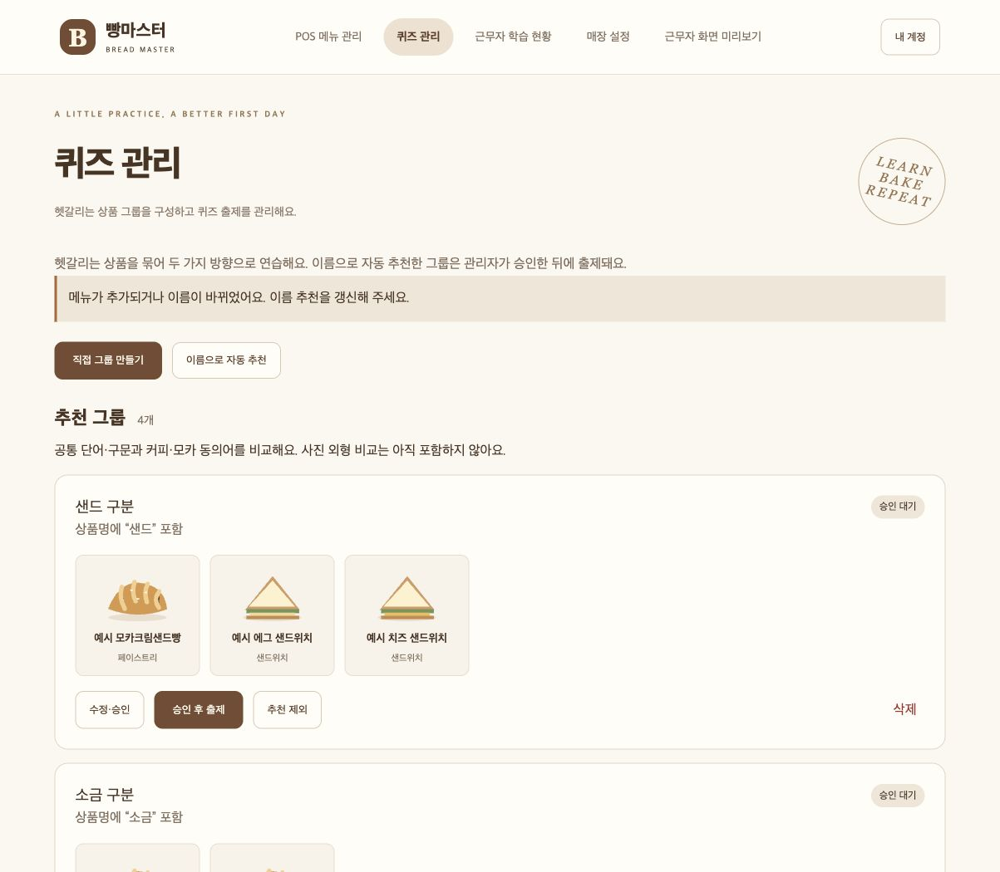
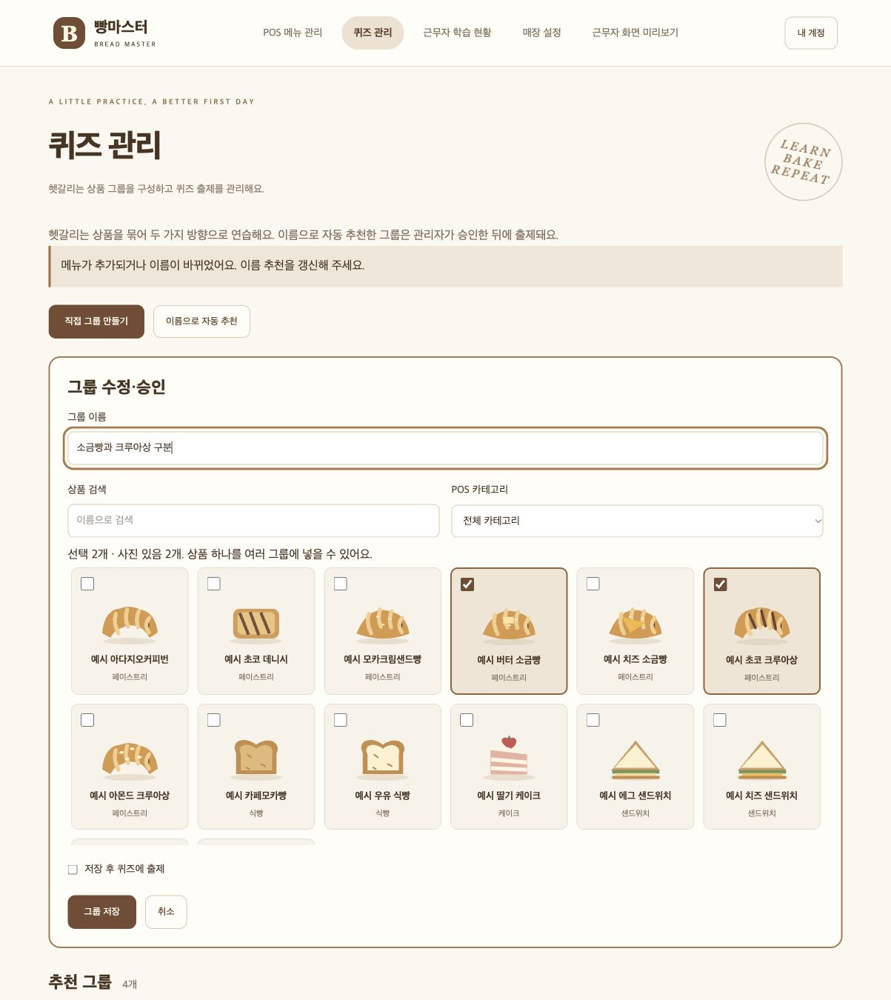
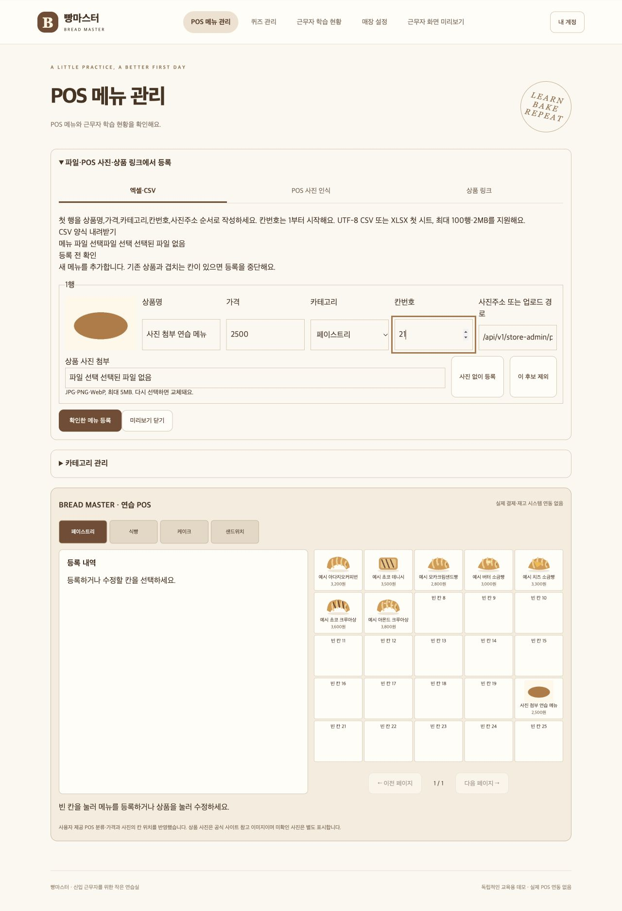

# 관리자 퀴즈 그룹 관리

관리자 상단 **퀴즈 관리**에서 매장의 헷갈리는 상품을 구성합니다. 사진 보고 이름 선택과 이름 보고 사진 선택이 같은 승인 그룹을 사용합니다. 매장별 변경이며 다른 매장이나 비로그인 공개 데모의 그룹은 바뀌지 않습니다.

## 사용 방법

1. 첫 방문에는 이름 추천을 준비합니다. 수량·입수 표기와 공백을 정리한 공통 2~6글자 구문, 커피·모카 동의어 사전으로 추천합니다. 빵·입, 크림 등 일반 표현만 같은 경우는 제외합니다. 외부 AI 호출이나 사진 외형 비교는 하지 않습니다.
2. 추천 이유와 상품 사진·이름·POS 분류를 확인합니다. 수정·승인에서 이름을 바꾸거나 상품을 추가·제외할 수 있습니다. 직접 그룹 만들기는 같은 상품을 여러 그룹에 선택할 수 있습니다.
3. 승인 후 출제를 누르면 양방향 퀴즈에 반영합니다. 사진이 있는 상품이 최소 두 개 필요합니다. 사진이 없는 메뉴를 포함해 출제 중지 상태로 저장할 수도 있습니다.
4. 그룹 수정·출제 중지·출제 시작·삭제를 지원합니다. 제외한 추천은 펼쳐서 다시 수정·승인할 수 있습니다. 삭제한 그룹은 목록에서 사라지고 같은 상품 구성의 추천 재생성을 억제하는 내부 기록만 남습니다.
5. 메뉴명 변경·새 메뉴 등록 후 퀴즈 관리에서 갱신 안내를 확인하고 이름으로 자동 추천을 누릅니다. 기존 승인·수정·제외 내용은 덮어쓰지 않으며 새로운 상품 구성이 생기면 별도 후보로 추가합니다.

보기는 그룹 안에서 정답과 다른 상품을 골라 2~4개로 표시합니다. 겹치는 그룹의 보기들을 합쳐 출제하지 않습니다. 한 라운드는 5문제이며 출제 가능한 상품을 모두 풀면 같은 상품을 반복합니다. 그룹을 바꾸더라도 이미 출제된 문제는 저장한 정답·상품 정보로 채점합니다.

## 메뉴 사진 함께 등록

기존 개별 메뉴 사진 업로드와 함께, CSV·XLSX·POS 인식·링크 후보의 각 행에서 상품 사진을 선택하거나 교체할 수 있습니다. JPG·PNG·WebP, 파일당 5MB와 기존 매장별 32MB 저장 한도를 유지합니다. 메뉴에 사진은 선택 사항입니다.

업로드 오류가 난 행은 메시지를 표시하고 등록을 막습니다. 다시 사진을 선택하거나 사진 없이 등록을 선택해 해소합니다. 메뉴 저장이 실패하면 입력값과 업로드한 사진이 유지되며, 수정 후 재시도합니다. 사진 파일은 메뉴 확인 저장 전에 서버에 업로드됩니다. 후보를 닫거나 사진을 교체할 때 사용하지 않는 업로드의 자동 정리는 아직 없으므로 해당 파일도 저장 한도에 포함됩니다.

## 저장과 호환성

- `store_quiz_settings`: 매장별 일회 이전 표시와 마지막 추천 상품명 지문.
- `store_quiz_groups`: 추천/승인/제외 상태, 출제 여부, 이름·추천 근거·추천 구성 키·삭제 표시.
- `store_quiz_group_products`: 그룹과 메뉴의 다대다 연결.
- 기존 매장은 서버 시작 때, 새 매장은 생성 때 기존 `name_group`을 승인된 그룹으로 한 번 이전합니다. 사진이 두 개 미만이면 출제 중지 상태로 이전합니다. 모두 삭제한 그룹을 서버 재시작이 복원하지 않습니다.
- 메뉴 API의 기존 `name_group` 입력은 호환성을 위해 받아들이되 그룹 수정에는 쓰지 않습니다. 기존 값은 보존하고, 새 그룹 구성은 전용 API를 사용합니다.

| API | 동작 |
| --- | --- |
| GET /api/v1/store-admin/quiz-groups | 매장 메뉴·카테고리·그룹과 추천 초기화/갱신 필요 상태 |
| POST /api/v1/store-admin/quiz-groups/recommend | 새 추천 추가, 기존 그룹 보존 |
| POST /api/v1/store-admin/quiz-groups/save | id 선택, name/product_ids/status/enabled로 생성·수정·승인·제외·중지 |
| POST /api/v1/store-admin/quiz-groups/{id}/delete | 해당 매장 그룹을 목록과 출제에서 제거 |

모든 관리 API는 승인된 매장 관리자만 접근합니다. 저장과 추천 갱신은 트랜잭션으로 처리하며 다른 매장 그룹 ID와 존재하지 않는 상품을 거부합니다. 출제 API 응답 형식은 유지합니다.

## 검증 자료

- 백엔드 전체 83개: 승인 전후 양방향 출제, 겹치는 그룹, 4개 보기 제한, 두 상품의 5문제 완료, 사진 부족, 권한·매장 격리, 일회 이전, 기존 문제 채점 보존, 추천 제외·삭제 보존, 사진 첨부 일괄 저장 실패·재시도·중복 방지.
- 프런트엔드 빌드·린트, 후보 파서와 사진 업로드 검사 총 4개 통과.
- 임시 매장 브라우저에서 추천 승인·수동 그룹 생성·출제 중지·제외 후 추천 갱신, 양방향 문제 생성과 채점, CSV 선택→사진 첨부→칸 충돌→수정·재시도, 잘못된 사진 형식 차단→정상 파일로 재시도 확인.
- 모바일 390px에서 문서 폭도 390px로 가로 넘침이 없음을 확인했습니다. 모든 화면 자료는 예시 상품·합성 사진이며 개인 매장 사진 원본이 아닙니다.

사진 외형 유사도 추천, 사진 여러 장의 파일명 자동 연결, POS 화면에서 개별 상품 사진 추출은 후속 작업입니다. 이름 추천은 구문 기반이므로 의미를 완벽하게 이해하지 못하며 관리자가 확인해야 합니다.
